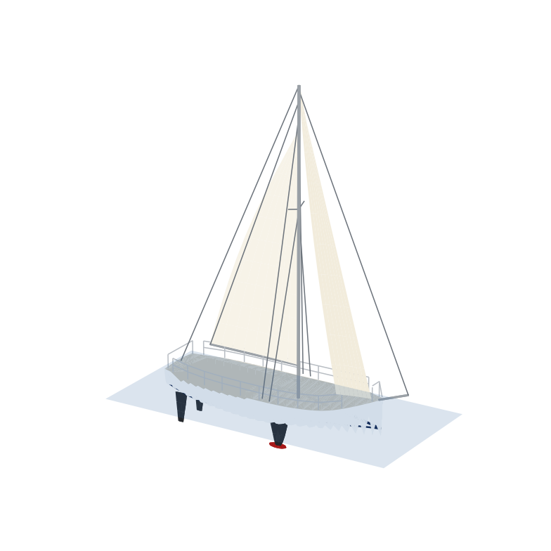
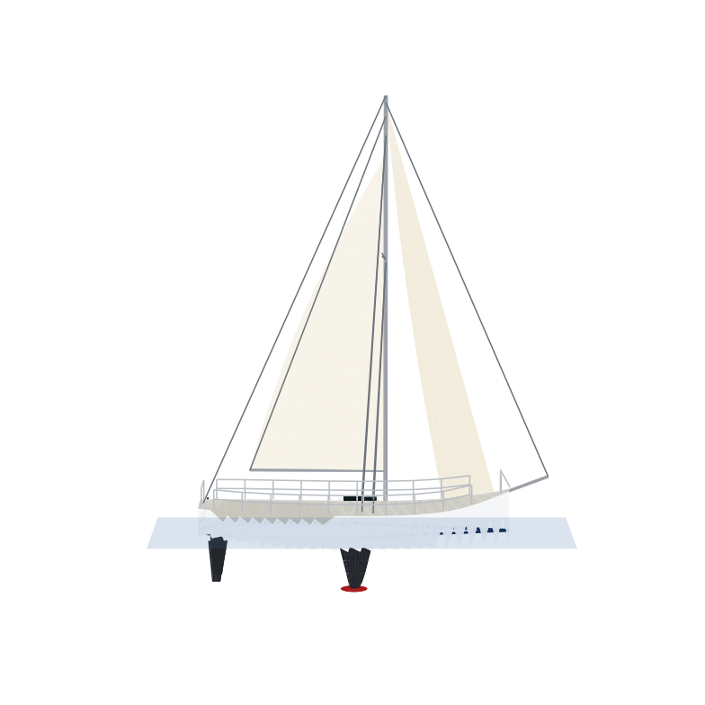
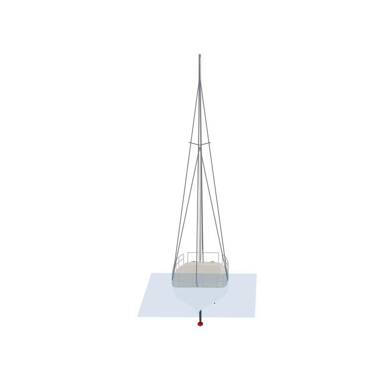
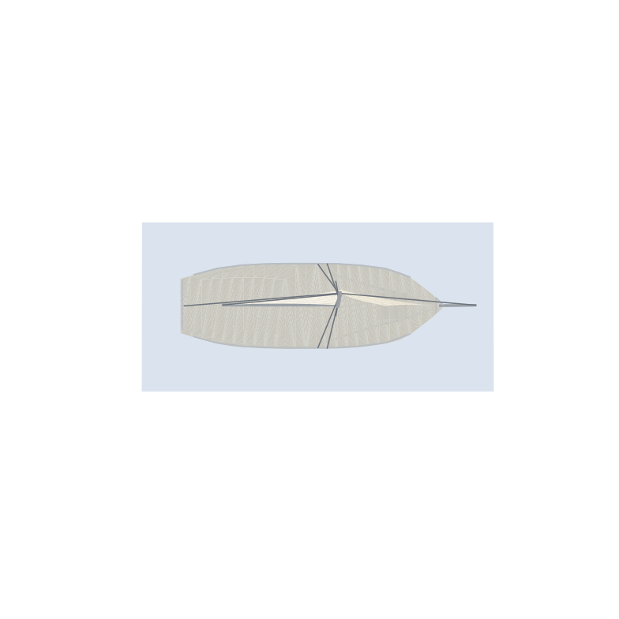
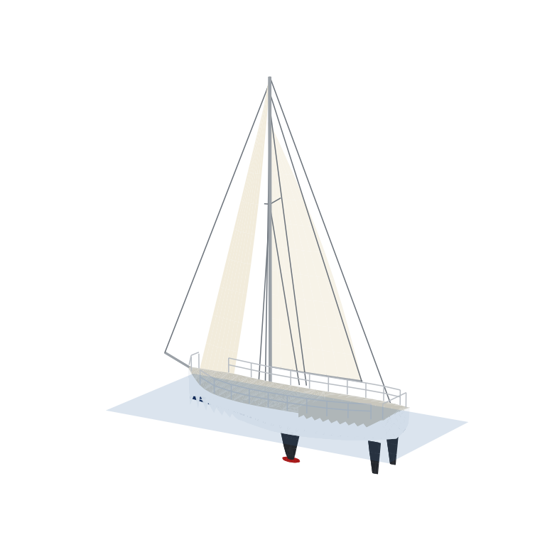
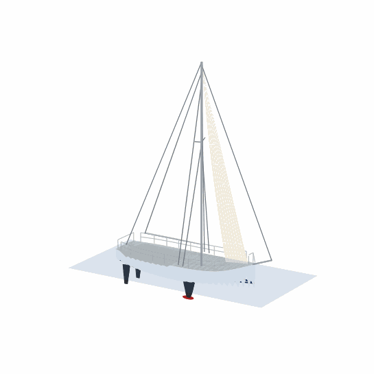

# First 30 JK — modèle 3D

🔗 **Voir le voilier en 3D tout de suite, en un clic (aucune installation) :**
👉 https://raw.githack.com/claudeprigentcp-bot/first-30-3D/efa7ed7/viewer-standalone.html

Voilier de course-croisière type **Bénéteau First 30 JK** (plan Juan Kouyoumdjian),
généré de façon paramétrique en Python (numpy/matplotlib uniquement pour la génération
et les rendus).

## Aperçus (le bateau s'affiche ici directement)



 

 



## Caractéristiques du modèle

| Paramètre | Valeur |
|---|---|
| Longueur hors tout (coque) | 9,81 m |
| Longueur avec bout-dehors | ~11,1 m |
| Bau | 3,20 m |
| Tirant d'eau (bulbe) | 1,90 m |
| Hauteur de mât au-dessus du pont | 13,0 m |
| Déplacement visé | ~3,75 t |

## Contenu du modèle

- Coque à bouchain arrière, étrave droite (plumb bow), livet de couleur
- Pont avec cockpit ouvert, bancs, roof avec hublots, trappe de pont avant
- Quille à bulbe, **double saumon** (2 safrans)
- Gréement sloop fractionnaire : mât, bôme, bout-dehors, haubans, étai, pataras
- Grand-voile (chute rondie) et génois sur étai, avec creux
- Bastingages, chandeliers, filières, pulpits, 2 roues de barre

## Fichiers (branche `vibe/first30jk-3d-ba467c`)

- `First30_JK.obj` + `First30_JK.mtl` — modèle 3D avec matériaux (18 groupes nommés)
- `First30_JK.stl` — version maillée pour impression 3D / CAO
- `make_first30.py` — générateur paramétrique
- `viewer.py` — rendu rapide : `python3 viewer.py First30_JK.obj sortie.png`
- `viewer.html` — visionneuse interactive Three.js (à servir sur HTTP, ex. GitHub Pages)
- `viewer-standalone.html` — **visionneuse 3D autonome** (WebGL vanilla, modèle embarqué, aucune dépendance) : télécharger le fichier et double-cliquer, fonctionne hors-ligne ; générée par `make_viewer_standalone.py`
- `preview_*.png` — rendus de contrôle (iso, side, front, top, stern)
- `First30_JK_animation.gif` — animation 3D (rotation 360° + roulis), générée par `animate_first30.py`

## Ouvrir le modèle

- **Blender / MeshLab / FreeCAD / Windows 3D Viewer** : ouvrir `First30_JK.obj`
- **Impression 3D** : utiliser `First30_JK.stl`
- **Navigateur, manipulable** : télécharger `viewer-standalone.html` (clic droit → enregistrer) et l'ouvrir dans un navigateur — orbite à la souris, zoom à la molette, pan au clic droit ; ou activer GitHub Pages (Settings → Pages, branche `vibe/first30jk-3d-ba467c`, racine `/`) puis ouvrir `viewer.html` en ligne

## Régénérer / modifier

```bash
pip install numpy matplotlib
python3 make_first30.py
```

Les cotes principales (LOA, bau, tirant d'eau, hauteur de mât) sont des constantes en
tête du script ; les profils de coque sont des points de contrôle interpolés en
Catmull-Rom.
